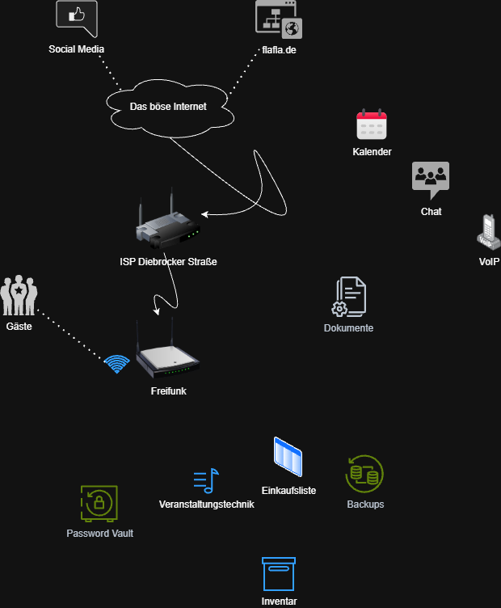

# FlaFla IT-Infrastruktur

Gruppenübergreifende Werkzeuge zur Verbesserung der Organisation und Erhöhung der Transparenz der Abläufe im FlaFla.

## Arbeitsweise

Die hier stattfindenden Arbeiten und Entwicklungen gehen zunächst von der **Finanz- und Verwaltungsgruppe** aus. Bei der Auswahl, Entwicklung und Installation von Werkzeugen soll allerdings darauf geachtet werden, dass diese nach Möglichkeit von **allen Gruppen** genutzt werden können und zur Transparenz im Haus beitragen. Es sollen **keine Insellösungen** für einzelne Gruppen oder Personen implementiert werden.

Ein weiterer wichtiger Aspekt ist das **Streuen von Wissen** und **Verhinderung von [technischen] Alleingängen**. Die etablierten Werkzeuge und Systeme müssen zu jedem Zeitpunkt von mehreren Menschen aus dem Haus gewartet und gepflegt werden können, es dürfen keine Engpässe und "single point of failures" geschaffen werden. Dokumentation und Akzeptanz für die geschaffenen Systeme sind von höherer Bedeutung als der Funktionsumfang.

**Vorschlag:** Verwaltung von Projekt und Unterlagen zunächst in einem Github-Repository. Dort können wir Dokumentation, Unterlagen und Code zwischenparken und haben das Material präsentationsbereit vorliegen für Entschiedungen in Huasversammlungen.

## Digitale Souverenität und Datenschutz

Neben den sehr guten ideologischen Gründen gibt es weitere Gründe, die IT-Infrastruktur im FlaFla möglichst souverän im eigenen Haus zu betreiben. Da im Rahmen der Vereins- und Kulturarbeit, **v.a. aber auch in der politischen Arbeit persönliche Daten verarbeitet werden müssen, ist hier besonderer Schutz nötig**. Genutzte Software-Dienste sollten nicht von amerikanischen Großkonzernen bereitgestellt werden, generell sollte auf Souverenität gesetzt werden in Form von eigenen Lösungen oder vertretbaren Alternativen. Dieser Punkt ist nicht zu unterschätzen, in einigen Bereichen muss aufgrund der Kritikalität der Daten auch über Verschlüsselung gesprochen werden, auch zum Schutz vor übergriffigen Behörden.

## Ausgangssituation, Priorisierung

Die letzte Struktur-HV am 08.11.2026 hat das **Bedürfnis für mehr Transparenz** sehr deutlich aufgezeigt: Zentrale Einkaufslisten, Kalender und Inventar sind drei Teilbereiche, die zur Sprache kamen. Daneben zeigte sich auch in vielen Punkten, dass eine bessere Verwaltung von HV-Protokollen zur Transparenz beitragen würde, z.B. wenn Beschlüsse schon längere Zeit zurück liegen und damit nicht mehr leicht zu finden sind.

Viele dieser Werkzeuge sind für sich genommen trivial und können auf unterschiedlichste Art umgesetzt werden. Um die Arbeitsweise einzuhalten ist es nötig, diese gemeinsam zu betrachten und sinnvoll zusammenzuschalten ( oder zu trennnen! ), je nachdem wie es der Geschäftsfall erfordert. Beispiel: Ein zentraler Kalender ist schnell gemacht. Die Frage nach "Wer darf welche Termine sehen?" ist sehr viel umfangreicher. Hier muss überlegt werden, ob ein Kalender mit komplexen Filterfunktionen, oder lieber mehrere Kalender mit verschiedenen Einsatzzwecken eingesetzt werden sollen.

### Grobe Aufstellung der Bereiche

- Infrastruktur ( WLAN, Backups, Laptops, Freifunk, Server?, Intranet?, VPN?! )
- Passwort- und Accountverwaltung ( Passwort Vault? )
- Protokolle ( HV, MJHV, Sonder-HVs, ... )
- Orga Termine ( Konzerte, Veranstaltungen, ... )
- Webseite, Social-Media-Auftritte ( nach Möglichkeit automatisiert bespielen! )
- Kommunikation ( Chat, VoIP-Conferencing, Voting, ... )
- Aufgabenverwaltung ( Zuweisung, Priorisierung, "Fristen"?!, Ticketsystem?!, ... )
- Materialwirtschaft ( Einkauf, Lager, Verbrauch, ... )
- Dokumente ( Gescannte Unterlagen, Schlüsselliste, Brandschutz, Betrieb, ... )

## Durchführung, nächste Schritte

Als nächstes muss eine genaue Priorisierung der Arbeitsbereiche in der Gruppe erfolgen. Sind die genannten Bereiche vollständig, priorisiert und somit sortiert, kann die nächste Phase starten: Erstellung und Erprobung von Lösungen unter Berücksichtigung der Arbeitsweise. Jede erstellte Lösung sollte dabei **frühstmöglich** im Plenum vorgestellt werden. Da jedes Werkzeug hier nach Möglichkeit **gruppenübergreifend** benutzt werden soll, ist breite Akzeptanz von größter Bedeutung. Es ist effizienter, prototypische Lösungen früh vorzustellen und zügig Feedback einzuholen, anstatt einnen langen Zeitraum isoliert zu arbeiten und damit die Akzeptanz der Lösungen zu gefährden. Weiterhin lohnt es sich, bei der Auswahl der Systeme auf eine gemeinsame Basis zu achten. Systeme, die mehrere Bereiche abdecken, sind leichter zu pflegen und zu warten als viele einzelne Programme oder Systeme.

## Systemskizze

Die Skizze zeigt den aktuellen groben Aufbau in Verbindung mit dem Internet, und listet mögliche digitale Dienste auf, wie ein ( oder mehrere?! ) Kalender, Chats, Einkaufsliste(n) usw. usf.. Die Herausforderung besteht jetzt in der Platzierung und Verknüpfung dieser potentiellen Inseln zu einem sinnvollen System, das auch zwischen öffentlichen Informationen und internen - schützenswerten (!) - Dingen unterscheiden kann. Außerdem müssen die einzelnen Punkte weiter aufgelöst und ergänzt werden. Tendenziell wird sichtbar, dass für einige der internen Dienste über eine Art "Intranet" nachgedacht werden könnte, in dem wichtige Informationen für hausinterne Menschen verfügbar sind. Ein alter Mini-Computer mit einem Dokumenten-Management wie "paperless", Backups und Passwortspeicher, der in einem physikalisch geschützten Bereich im Fla steht und im einem internen Netzwerk per WLAN verfügbar ist, wäre ein möglicher Start. Mit jedem Projektschritt kann die Systemskizze ergänzt werden, sowie nach und nach in Dokumentation aufgehen, sodass die verfügbaren Dienste für alle Menschen transparent sind.

## Ideen

- Subdomains?! cloud.flafla.de oder ähnliches wären prima Umleitungen, um schlechtere DynCNS-Adressen in merkbare Adressen zu verwandeln
