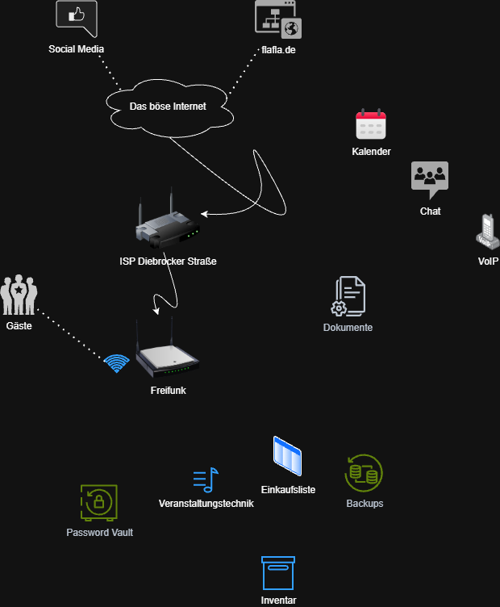

# Arbeitspakete Phase 1

## Systemskizze

## Termine

Über nuudel vereinbaren?

## WP0 - Bestandsaufnahme Netzwerk und Hardware

Aktuellen Stand festhalten und dokumentieren, Zugangsdaten zentral aber geschützt verfügbar machen.

- Internetzugang im Keller: Zugang Netzwerk, Zugang Router Konfiguration
- Freifunk-Router: Zugang dokumentieren, Netzübergang, Zugangsdaten Router Konfiguration
- Laptops / Bürorechner: Benutzer-Accounts, Netzwerkzugänge

**Definition of done:**
- Zugangsdaten für Internetzugang, Netzwerke und Laptops sind vorhanden und geschützt abgelegt ( zunächst ist ein Blatt Papier im Büro oder Safe völlig OK! )
- Aktuelle Netzwerkinfrastruktur dokumentieren: Welche Netze? Wie erreichbar? Zugangsdaten? Zweck?
- Für die wichtigsten hausinternen Geräte wie Router und Laptops existiert ein einfaches digitales Inventar ( Excel-Mappe, CSV, Textdatei, ... )
- Die FlaFla-IT-Systemskizze löst die aktuellen Netzwerke hinter dem zentralen Zugang ( ISP ) korrekt und möglichst detailliert auf

**(Optional) Bonus Level**
- Liebevolle Doku: Fotos machen, Social-Media?, öffentliche Systemskizze, F.A.Q.s, Notfallpläne ( Was tun wenn kein Internet? )

## WP1 - Basis, Netzwerk

Netzwerke im FlaFla so vorbereiten, dass spätere interne und externe Systeme/Dienste bequem darin platziert und betrieben werden können.

- Netzaufteilung, DSP: Öffentlich vs. hausintern, Freifunk für öffentliches WLAN
- WLAN-Abdeckung, Verkabelung: Wo muss welches Netzwerk wie verfügbar sein?
- Infrastruktur, Geräte: Drucker und VoIP-Endgerät(e) sauber einbinden

**Definition of done:**
- Transparenz über bestehende Netzwerke und deren Zugänge
- Getestete und dokumentierte Netzabdeckung nach Bedarf ( Beispiel: Kneipe, Disco, Innenhof --> öffentliches WLAN; LAN-Dosen für intern --> Büro; ... )
- Vorbereitete und bekannte Möglichkeiten, neue Geräte und Dienste in die jeweiligen Netze einzubringen (Drucker, VoIP-Telefone, PCs, Server, ... )
- Die FlaFla-Netzwerke und die Systemskizze wurden so ergänzt, dass spätere Dienste wie Passwortspeicher und Dokumentenmanagement darin platziert werden können
- Lücken in der Abdeckung sind bekannt und wurden in Anschaffungslisten für Kabel, WLAN-Repeater, Switches usw. überführt

**(Optional) Bonus Level**
- Liebevolle Doku: Fotos machen, Social-Media?, öffentliche Systemskizze, F.A.Q.s, Notfallpläne ( Was tun wenn kein Internet? )
- Schnorren gehen! Wer hat Laptops, Router, Switches, Repeater, Barcodescanner, ... rumliegen?

## WP2 - Platform Playground Phase

Die neu gewonnene Transparenz über die Infrastruktur nutzen, eine Spielwiese aufbauen und erste Dienste erproben.

- Platform etablieren: Mini-PC (z.B. Raspberry-Pi, oder altes Laptop) als Basis, eingebunden und erreichbar im internen Netzwerk
- Dienste ausprobieren: "paperless", "nextcloud", ...
- Schulen, Wissen streuen, motivieren, aber auch Spielregeln: Sobald hier eine Spielwiese besteht, muss auch Gardening betrieben werden

**Definition of done:**
- Es gibt eine funktionierende Platform für interne Werkzeuge im FlaFla, z.B. ein Speicher für Passwörter und Zugangsdaten
- Die geschaffene Platform kann von mehr als einer Person im Haus komplett betreut werden: Installation **und** Betrieb!
- Für die neu geschaffene Platform gibt es gute und leicht verständliche Dokumentation, die neuen Menschen die Mitarbeit und den Einstieg erleichtert
- Die Systemskizze zeigt die neue interne Platform, ordnet sie netzwerktechnisch korrekt ein und weist ihr erste Dienste zu

**(Optional) Bonus Level**
- Dyn-DNS, VPN, SSH, phonehome: Externe Wartungskanäle schaffen, erste externe Zugänge erproben
- Liebevolle Doku: Fotos machen, Social-Media?, öffentliche Systemskizze, F.A.Q.s, Notfallpläne ( Was tun wenn kein Internet? )
